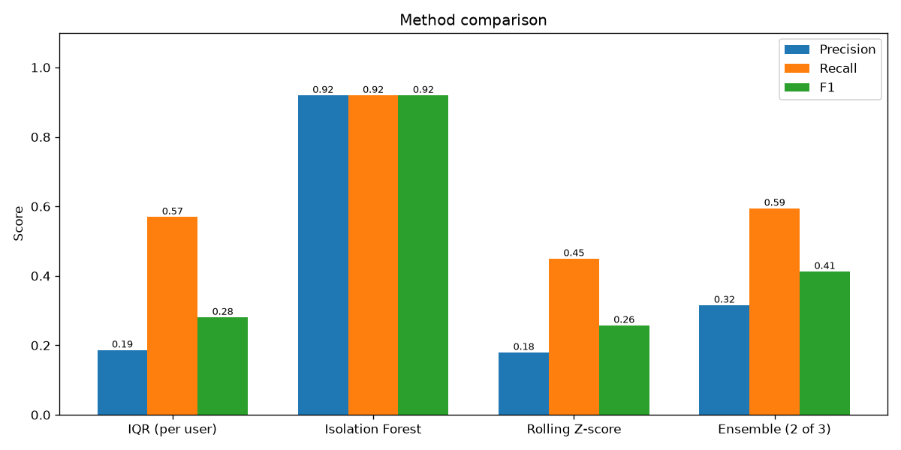

# UPI Fraud Detection
Real-time fraud detection for UPI payments. Three anomaly detection methods (IQR, Isolation Forest, rolling z-score) and an ensemble are compared on 10,000 synthetic transactions. The best model is served through a FastAPI service and a live Streamlit dashboard with risk levels, filters, trend charts and alerts.
**Live demo:** [https://upi-fraud-detector-2026.streamlit.app](https://upi-fraud-detector-2026.streamlit.app)
> All data in this project is synthetic. Please read the "Limitations" section.
## Problem
UPI payments are instant and irreversible, so fraud has to be caught while the payment happens. Fraud usually looks different from a user's own normal behaviour: a very large amount, a late-night payment, a new device, a new city, or many transfers in a few seconds. This project detects such behaviour without using fraud labels for training.
## Features
- Synthetic data: 10,000 transactions, 500 users, about 2% fraud (large amount, 2-4 AM, new device, new city, bursts of 5+ transfers within a minute)
- 7 engineered features per transaction (amount z-score vs the user, hour, new device, new city, transactions in the last hour, time since last transaction)
- 3 methods plus an ensemble, compared with precision, recall, F1 and confusion matrices
- FastAPI service: `POST /check`, `GET /health`, `GET /recent`, `GET /alerts`
- Risk levels (LOW, MEDIUM, HIGH) with plain-language reasons
- Streamlit dashboard: live feed, filters, trend charts, alerts tab, method comparison
- Alerts for HIGH risk transactions: log file, dashboard, optional Telegram, email and SMS
## Methods
| Method | Idea |
|---|---|
| IQR per user | Flag if the amount is above Q3 + 1.5 x IQR of that user |
| Isolation Forest | Unsupervised model on the 7 engineered features (contamination 0.02) |
| Rolling z-score | Flag if the amount is more than 3 standard deviations above the user's recent spending |
| Ensemble | Flag if at least 2 of the 3 methods agree |
`is_fraud` is used only for evaluation. No model is trained with it.
## Architecture
```
  simulate.py / demo traffic
            |  POST /check
            v
  +-------------------------+       +------------------------+
  |  FastAPI (api/main.py)  | ----> |  Isolation Forest      |
  |  features + risk level  |       |  models/*.joblib       |
  +------------+------------+       +------------------------+
               |
               |  GET /recent, GET /alerts
               v
  +-------------------------+
  |  Streamlit dashboard    |
  |  (app.py)               |
  +-------------------------+
```
## Tech stack
Python, pandas, NumPy, scikit-learn, matplotlib, FastAPI, Uvicorn, Pydantic, Streamlit, joblib.
## How to run
**Windows (PowerShell):**
```
python -m venv .venv
.venv\Scripts\activate
pip install -r requirements.txt
python run_all.py
```
**Mac / Linux:**
```
python3 -m venv .venv
source .venv/bin/activate
pip install -r requirements.txt
python run_all.py
```
`run_all.py` generates the data, trains the model, evaluates every method, saves the charts and fills the results table below.
Then start the live demo in three separate terminals:
```
uvicorn api.main:app --port 8000
python simulate.py
streamlit run app.py
```
Open http://localhost:8501 for the dashboard and http://127.0.0.1:8000/docs for the API docs.
To get demo traffic without `simulate.py`, set the environment variable `DEMO_SIMULATOR=on` before starting the API.
## Results
<!-- RESULTS_TABLE_START -->
| method | flagged | precision | recall | f1 | tp | fp | fn | tn |
|---|---|---|---|---|---|---|---|---|
| IQR (per user) | 610 | 0.187 | 0.57 | 0.281 | 114 | 496 | 86 | 9304 |
| Isolation Forest | 200 | 0.92 | 0.92 | 0.92 | 184 | 16 | 16 | 9784 |
| Rolling Z-score | 499 | 0.18 | 0.45 | 0.258 | 90 | 409 | 110 | 9391 |
| Ensemble (2 of 3) | 376 | 0.316 | 0.595 | 0.413 | 119 | 257 | 81 | 9543 |
<!-- RESULTS_TABLE_END -->

## Screenshots

## Risk levels
| Level | Meaning |
|---|---|
| HIGH | The model flags fraud and the score is well above its threshold |
| MEDIUM | The model flags fraud, or the score is close to the threshold |
| LOW | Normal behaviour |
## Alerts
Every HIGH risk transaction is saved in `data/alerts.log`, shown in the Alerts tab of the dashboard, and shown as a popup. Optional channels are switched on with environment variables (never commit them):
| Channel | Environment variables |
|---|---|
| Telegram | `TELEGRAM_BOT_TOKEN`, `TELEGRAM_CHAT_ID` |
| Email (SMTP) | `SMTP_USER`, `SMTP_PASSWORD`, `ALERT_EMAIL_TO` |
| SMS | `ALERT_PHONE_TO`, `FAST2SMS_API_KEY` |
## Deploy on Streamlit Community Cloud
The dashboard is deployed from this GitHub repository. On start it creates the data and the model (`run_all` steps), starts the FastAPI service inside the same process, and the API generates its own demo traffic (`DEMO_SIMULATOR=on`).
- Main file: `app.py`, Python 3.12
- `bootstrap.py` starts the API in a background thread when no API is running
- Free apps sleep after about 12 hours without traffic, so the first visit after a break can take a minute
## Project structure
```
api/            FastAPI service (main.py, notifier.py, demo_sim.py)
src/            generate.py, features.py, detect.py, evaluate.py
app.py          Streamlit dashboard
simulate.py     sends live fake transactions to the API
run_all.py      generate -> detect -> evaluate
docs/           screenshots and charts used in this README
```
## Limitations
- The data is synthetic and I created the fraud patterns myself, so the accuracy is optimistic and real-world results will be lower.
- Isolation Forest is trained and evaluated on the same data, and its contamination value (2%) equals the true fraud rate. A real system does not know this in advance.
- The ensemble is weaker than Isolation Forest here because two of its three methods look only at the amount.
- A real system needs labelled data from investigators, a time-based train/test split, and a feedback loop that retrains the model.
- API history and alerts are kept in memory and reset when the API restarts.
## Author
Dipanshu Gupta - GitHub: [dipanshu-2106](https://github.com/dipanshu-2106)
